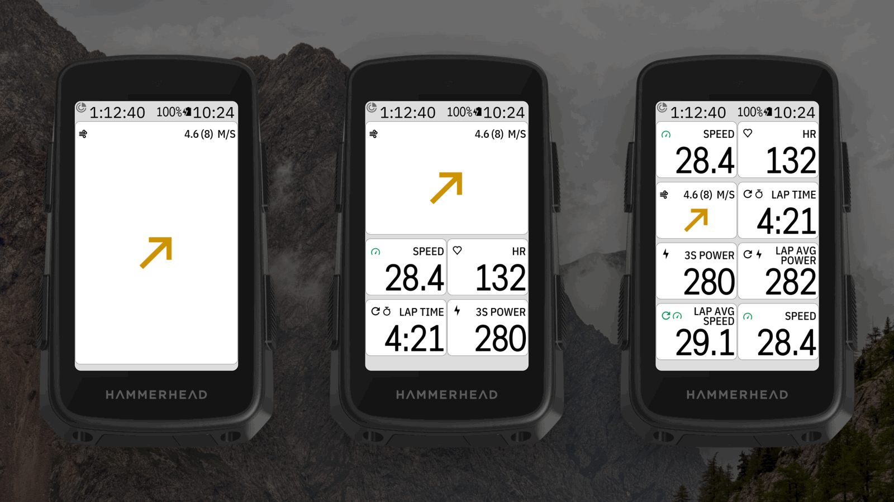
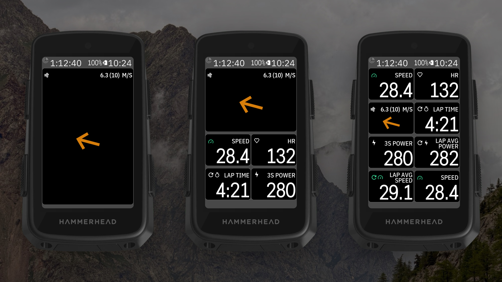

<!-- docs.sh: generated from docs/app.yml. Edit that file and run setup/docs.sh, not this block. -->

# ClearWind for Karoo 3

Listed on the Karoo as **DDB ClearWind**, next to the other DDB apps.

A data field for the Hammerhead Karoo 3 that shows the wind turned to the way you ride, built to be
read at a glance.

- **Arrow:** points the way the wind blows (up = tailwind, down = headwind), as big as the field allows.
- **Header like the Karoo's own fields:** wind icon left, average wind and gusts right, like yr.no (`5.2 (9) M/S`).
- **Arrow colour:** by wind speed (green → red), black/white, or Karoo green, picked in Settings.
- **Tile colour (optional):** the whole field tinted by wind strength in the Karoo's zone colours, text and arrow kept black/white (WCAG AAA contrast).
- **Settings in the Karoo's app list:** wind speed in knots, m/s, km/h or mph, tile colour, arrow colour, and show gusts on or off.
- **Long-press the field** to swap it for another, like any Karoo field.
- **Remote button actions:** switch units and switch arrow colour.

Wind comes from Open-Meteo (free, no API key) for your location, every 10 minutes or after 5 km (average wind at 10 m and the past hour's strongest gust),
fetched through the Karoo's Wi-Fi or the Hammerhead phone app; your position is rounded to about
1 km. Heading comes from the Karoo. Every build shows only real data: wind from Open-Meteo, heading from the Karoo.

More in the [rider guide](docs/guide/README.md).

Building it yourself or making a release: see [docs/DEVELOPING.md](docs/DEVELOPING.md).

## Install on your Karoo

1. On your phone, open the [latest release](https://github.com/Dubadai/karoo-clearwind/releases/latest)
   and share `clearwind.apk` to the **Hammerhead Companion** app (or with a computer: `adb install clearwind.apk`).
2. In a ride profile, add **DDB ClearWind → ClearWind** to a page, at any size.
3. Open **DDB ClearWind** from the app list to pick the units, tile colour and arrow colour.

<!-- /docs.sh -->

## Licence

MIT, see `LICENSE`. The included Karoo SDK in `karoo-ext/` is Apache 2.0, see `karoo-ext/LICENSE`.
