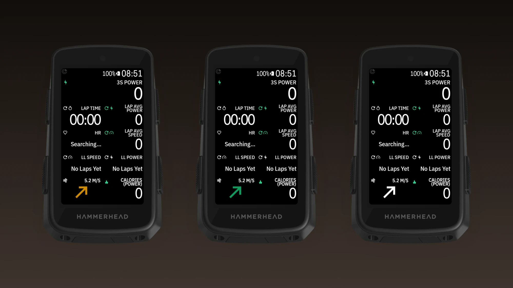
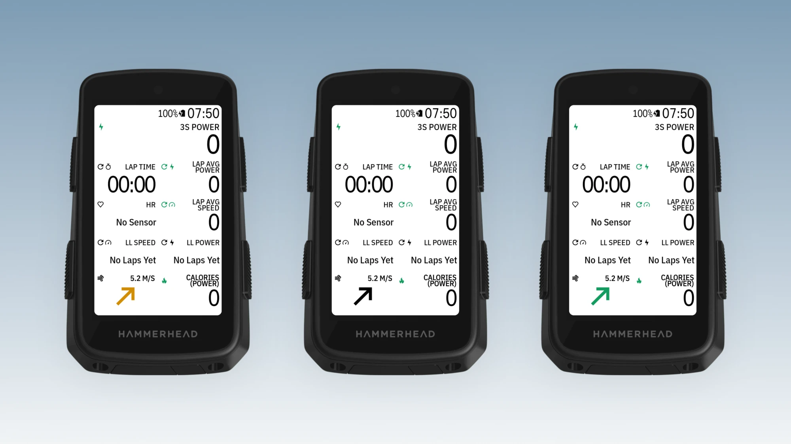

# Karoo ClearWind

A data field for the Hammerhead Karoo 3 that shows the wind turned to the way you ride, built to be
read at a glance.




- **Arrow:** points the way the wind blows (up = tailwind, down = headwind), as big as the field allows.
- **Header like the Karoo's own fields:** wind icon left, wind speed right (`5.2 M/S`).
- **Arrow colour:** by wind speed (green → red), black/white, or Karoo green, picked in Settings.
- **Settings in the Karoo's app list:** wind speed in knots, m/s, km/h or mph, and the arrow colour.
- **Long-press the field** to swap it for another, like any Karoo field.
- **Remote button actions:** switch units and switch arrow colour.

Wind comes from Open-Meteo (free, no API key) for your location, every 10 minutes or after 5 km,
fetched through the Karoo's Wi-Fi or the Hammerhead phone app; your position is rounded to about
1 km. Heading comes from the Karoo. Debug builds show demo data; release builds never do.

**Install:** download the APK from [Releases](https://github.com/Dubadai/karoo-clearwind/releases),
sideload it, then add the field: Profiles → a ride page → tap a field → ClearWind.
More in the [rider guide](docs/guide/README.md).

Developers: read `../CLAUDE.md` (the Karoo playbook) first.

## Build and install

```bash
export JAVA_HOME="/Applications/Android Studio.app/Contents/jbr/Contents/Home"
./gradlew -q assembleDebug
adb install -r app/build.nosync/outputs/apk/debug/app-debug.apk
```

Then add the field to a ride page on the Karoo (Profiles → page → ClearWind).

## Licence

MIT, see `LICENSE`. The included Karoo SDK in `karoo-ext/` is Apache 2.0, see `karoo-ext/LICENSE`.
