# User guide

Plain-language pages for riders, one per feature, with screenshots in `images/`.

## ClearWind field

**Add it:** on the Karoo, Profiles → pick a profile → a ride page → tap a field → DDB ClearWind → ClearWind.
It works at any field size.

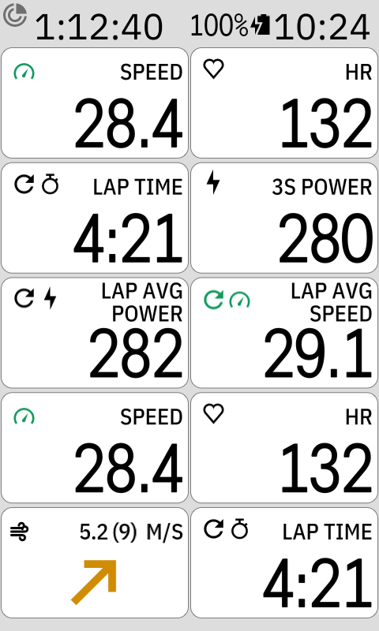 
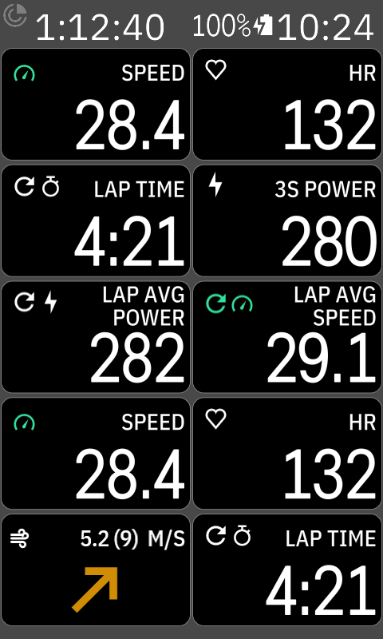

**Read it:**
- The **arrow** shows which way the wind is blowing, turned to the way you ride. Up is straight
  ahead: an arrow pointing up is a tailwind, pointing down at you is a headwind.
- The arrow's **colour**: pick one of three styles in Settings, and it's remembered:
  1. by wind speed: green is light, through yellow and orange, to red at 12 m/s and above;
  2. plain black (white in dark mode);
  3. Karoo green.

  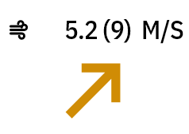 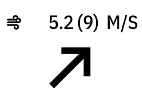 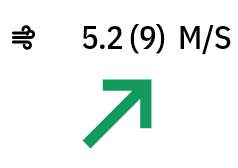 
  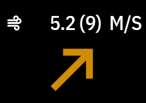 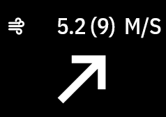 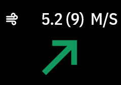
- The top row is like other Karoo fields: a wind icon on the left and the wind on the right, like
  yr.no: the average speed, the gusts in brackets, then the unit. **5.2 (9) M/S** means 5.2 m/s on
  average with gusts up to 9. With no gust data the brackets are left out. Prefer just the
  average? Turn off **Show gusts** in Settings and it reads **5.2 M/S**.

  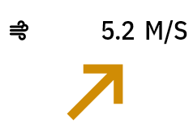 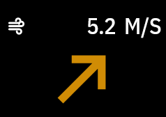
- **Tile colour** (Settings, off to start with) colours the whole field by wind strength, in the
  Karoo's own zone colours, toned down: green below 2 m/s, then teal, yellow, salmon, red, and
  purple from 11 m/s. The text and arrow stay black (white in dark mode) so they're easy to read in
  every colour. With a coloured tile the arrow colour setting is switched off.

  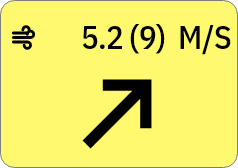 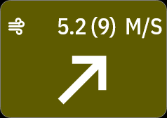
- In a bigger field the arrow grows to fill it. In each field it keeps one size, whatever the
  numbers say:

  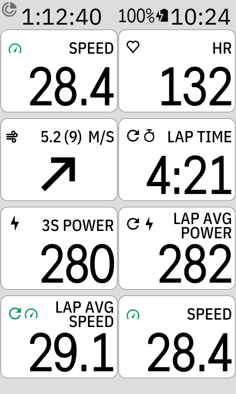 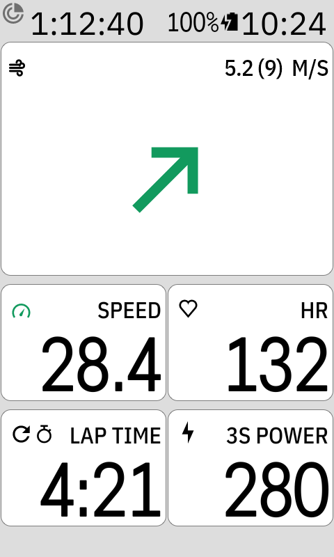 
  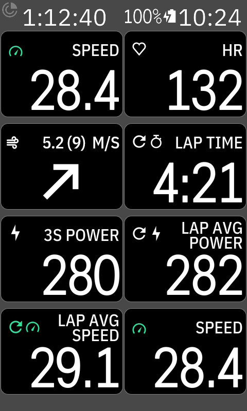 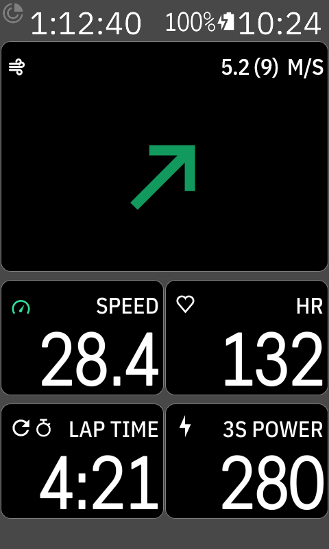

**Settings:** open DDB ClearWind from the Karoo's app list to pick the wind speed unit (knots, m/s,
km/h or mph; m/s to start with), the tile colour, the arrow colour and whether to show gusts.
The **Example** at the top shows the field with your choices, and changes as you tap.

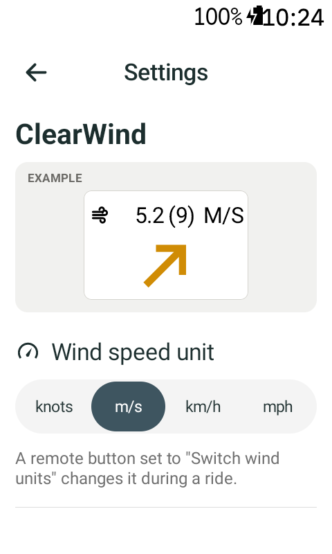

At the end of the page: **Update notices** (a card on the field when a new version is out; on to
start with) and the version you have.

**During a ride:** put "Switch wind units" on a remote button (Settings → Controllers) to step
through the units. There's also "Switch arrow colour" for a remote button. Every choice is remembered.

**Change the field:** long-press it, as with any Karoo field. Tapping the field does nothing.

**Where the wind comes from:** Open-Meteo weather for where you are, fetched through the Karoo's
Wi-Fi or the Hammerhead phone app, every 10 minutes (sooner after 5 km). No account or key needed.
**No wind yet:** like the Karoo's own fields, the tile says so. **Searching…** (grey wind icon)
until the first wind arrives; **No connection** (grey icon) when the weather can't be
fetched. Once ClearWind has wind, it keeps showing it if a later fetch fails.

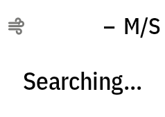 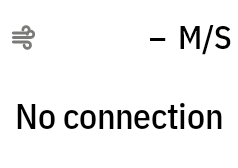 
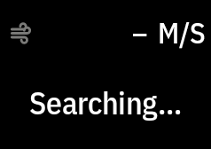 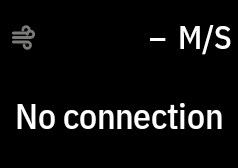
