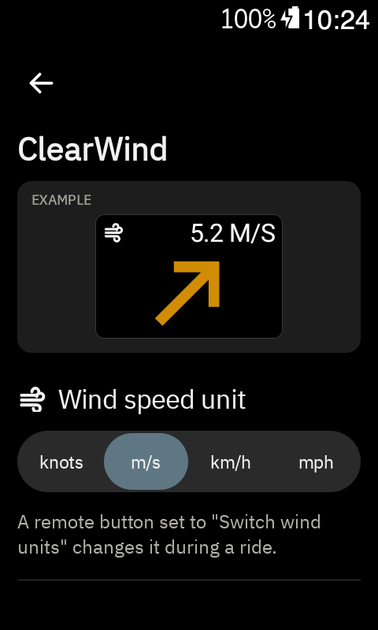

# User guide

Plain-language pages for riders, one per feature, with screenshots in `images/`.

## ClearWind field

**Add it:** on the Karoo, Profiles → pick a profile → a ride page → tap a field → DDB ClearWind → ClearWind.
It works at any field size.

 

**Read it:**
- The **arrow** shows which way the wind is blowing, turned to the way you ride. Up is straight
  ahead: an arrow pointing up is a tailwind, pointing down at you is a headwind.
- The arrow's **colour**: pick one of three styles in Settings, and it's remembered:
  1. by wind speed: green is light, through yellow and orange, to red at 12 m/s and above;
  2. plain black (white in dark mode);
  3. Karoo green.
  A grey arrow means no wind data yet.

    
- The top row is like other Karoo fields: a wind icon on the left and the wind speed with its
  unit on the right (for example 5.2 M/S).
- In a bigger field the arrow grows to fill it:

   

**Settings:** open DDB ClearWind from the Karoo's app list to pick the wind speed unit (knots, m/s,
km/h or mph; m/s to start with) and the arrow colour.
The **Example** at the top shows the field with your choices, and changes as you tap.

 

**During a ride:** put "Switch wind units" on a remote button (Settings → Controllers) to step
through the units. There's also "Switch arrow colour" for a remote button. Every choice is remembered.

**Change the field:** long-press it, as with any Karoo field. Tapping the field does nothing.

**Where the wind comes from:** Open-Meteo weather for where you are, fetched through the Karoo's
Wi-Fi or the Hammerhead phone app, every 10 minutes (sooner after 5 km). No account or key needed.
Without a connection the speed shows "–".
